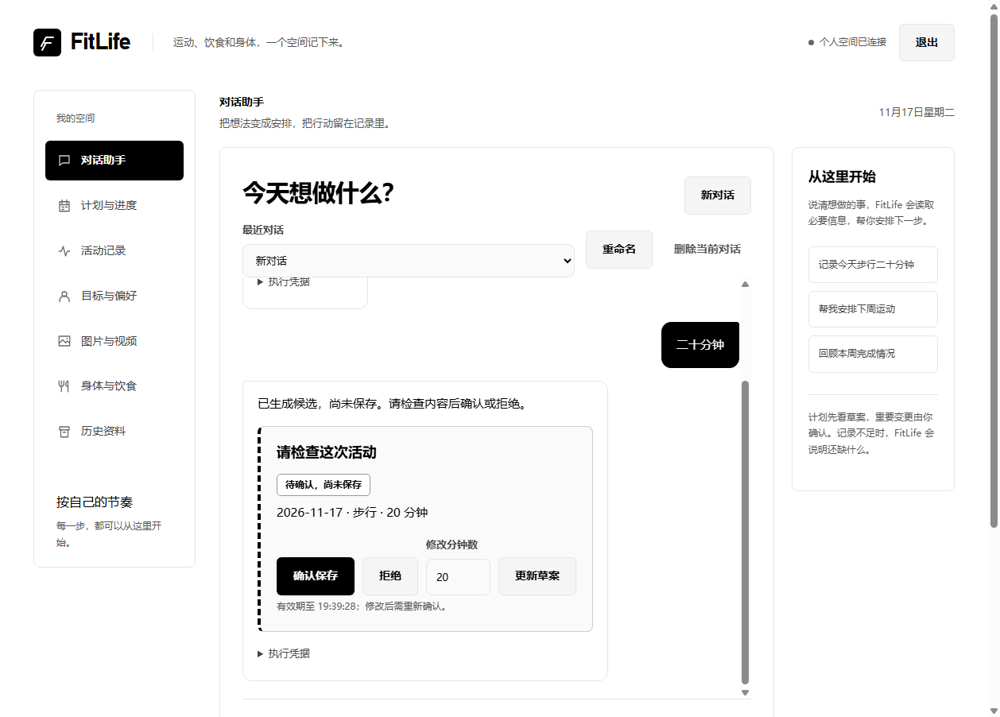
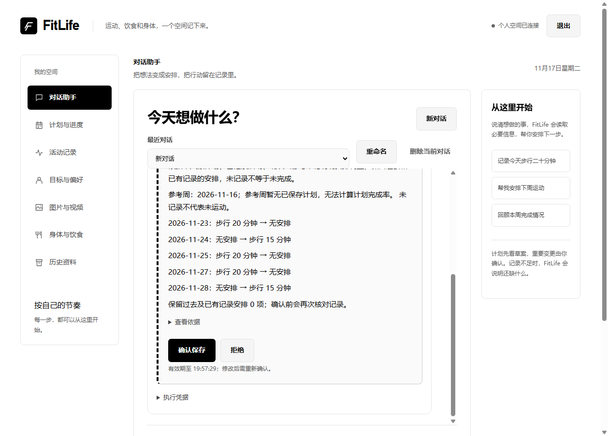
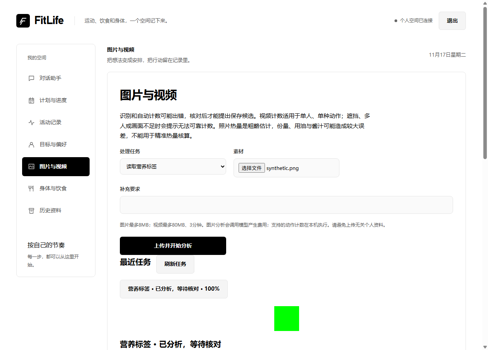
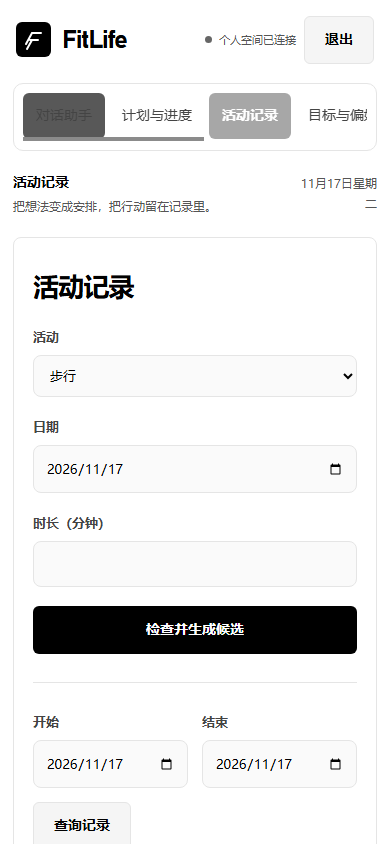
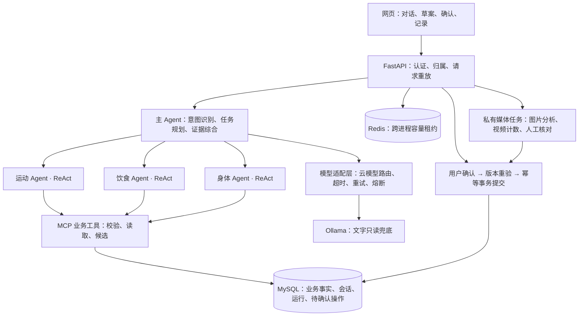

# FitLife · 基于多 Agent 的个人健康助手

[](https://github.com/n0future37/FitLife/actions/workflows/checks.yml)

用对话安排运动、记下饮食与身体变化，再根据实际记录调整计划。重要变更先展示草案，由用户核对后保存。

**Python 3.12 · OpenAI SDK · MCP · FastAPI · SQLAlchemy · Alembic · MySQL · Redis · Docker**



## 功能一览

| 功能 | 可以完成的操作 |
| --- | --- |
| 自然语言助手 | 记录活动、查询事实、生成计划草案；跨运动、饮食、身体领域拆分任务并交接结果，缺少必要参数时补问 |
| 运动计划与进度 | 生成周计划、查询版本和完成情况；结合活动记录调整后续安排，展示调整前后的差异和依据 |
| 运动与训练记录 | 记录步行等活动的日期与时长，维护步数、力量训练与反馈，按日期查询统计，确认后删除 |
| 饮食与营养核算 | 维护食物资料，按每100g或100ml信息计算摄入营养，保存餐食快照并查询历史 |
| 身体数据 | 管理身高等档案，按日期记录体重、体脂、腰围、睡眠和疲劳，并查询区间变化 |
| 目标、偏好与记忆 | 保存经确认的目标和偏好，支持更正与忘记；保留近期会话和有日期范围的临时约束 |
| 餐食照片与营养标签 | 上传图片、后台分析、展示粗略热量和营养观察，支持人工更正与确认保存 |
| 力量训练视频 | 上传单人、单动作视频，指定深蹲、俯卧撑、弯举、仰卧起坐、引体向上或卧推，进行本地实验性计数；支持手动更正并保留自动证据 |
| 会话管理 | 新建、恢复、删除会话，首轮自动概括名称，也可手动重命名；桌面与移动端可用 |
| 确认与恢复 | 草案可拒绝或修改，变更后旧确认失效；重复确认不重复写入，失败请求可恢复 |
| 多模型接入 | 配置不同供应商和模型，按任务选择，提供超时重试、熔断及文字只读任务的本地兜底 |

餐食图片是粗略估计；视频在遮挡、多人或信号不足时可能不给总数，弯举尚未完成真实准确率评测。核对和确认后才保存。应用提供一般运动与习惯管理辅助，不作医疗诊断或治疗建议。

## 典型流程

**记录活动**：输入“记录今天步行二十分钟” → 生成包含日期、活动和时长的候选 → 用户确认 → 保存并可查询。只说“今天走了走”而缺少时长时，先补充必要信息。

**调整计划**：提出调整要求 → 读取已有计划、画像与活动记录 → 展示前后差异及依据 → 确认时重新核对数据版本 → 保存新版本。

**从媒体到记录**：上传餐食图片或指定动作的视频 → 查看后台处理状态 → 核对估算或次数并更正 → 生成候选 → 确认保存。自动观察和用户更正分别保留。

## 更多界面

### 计划调整：展示变化与依据



### 图片上传、后台任务与结果核对



### 移动端活动记录



演示页面使用临时合成用户与固定模型响应，媒体示例为合成色块，不包含私人数据。截图展示真实应用流程；模型与视觉效果另见下方独立评测。[演示素材说明](docs/demo.md)

## 架构与执行边界



- **主从协作**：主 Agent 输出领域任务与依赖；子 Agent 按依赖接收前序结果。模型提出计划，服务端负责结构、权限、工具参数与写入规则。
- **记忆与上下文**：近期对话、临时约束、确认画像和业务事实分别管理。画像按需读取，支持确认更正和忘记；当前默认使用近期会话上下文，不是向量长期记忆。
- **可靠写入**：确认与具体草案、内容和版本绑定；过期、修改或源数据变化会使旧确认失效。确认、重试和恢复共用服务端幂等机制。
- **模型可靠性**：配置分离供应商、协议、模型和密钥环境变量；支持超时、有限重试与熔断。本地兜底仅用于文字只读任务，写入失败会明确返回未完成。
- **存储**：MySQL 是权威数据源；Redis 提供跨进程容量控制，开发 DB2、测试 DB3，另加环境前缀。当前核心功能不依赖 Milvus。

保留三领域、43 项工具能力的 `unified` 单 Agent 基线；默认 `master` 为主从编排。`single` 是早期运动领域基线，不能与同能力 `unified` 混为一谈。

## 本地运行

### 1. 准备依赖

需要 Python 3.12、MySQL 8.4、Redis 7.4；媒体处理需要 FFmpeg/FFprobe。浏览器验收额外需要 Chrome。数据库不随源码提供。

```powershell
git clone https://github.com/n0future37/FitLife.git
cd FitLife
python -m pip install -e ".[dev]"
# 需要本地视频姿态计数时安装额外依赖及版本化权重
python -m pip install -e ".[media]"
python -m fitlife.pose_setup --download
```

请使用你自己的解释器或虚拟环境。姿态权重由命令显式下载并校验，不随仓库分发。

### 2. 配置数据服务与身份

在自己的 MySQL 中分别准备 `fitlife_dev` / `fit_dev`、`fitlife_test` / `fit_test`，仅授予对应数据库权限。默认地址为 `127.0.0.1:3306`，Redis 为 `127.0.0.1:6379`。

Windows 可以通过系统凭据管理器保存数据库密码；命令在本机隐藏读取，不要把密码、令牌发到聊天或写入仓库：

```powershell
python -m fitlife.credentials --environment dev
python -m fitlife.credentials --environment test
python -m fitlife.manage --environment dev
```

`manage` 校验数据库身份、执行迁移并签发个人令牌；令牌仅用于本机网页登录。已有用户续签时加 `--user-id <自己的用户UUID>`。其他环境可通过安全注入 `FITLIFE_DB_PASSWORD` 提供密码；Redis 支持 `FITLIFE_REDIS_PASSWORD_FILE` 或 `FITLIFE_REDIS_CREDENTIALS_FILE`。配置项见 [.env.example](.env.example) 与 [部署说明](docs/deployment.md)，`.env.example` 是参考，不会自动加载模型配置。

### 3. 配置模型并启动

模型密钥由本机环境或 secret 文件提供，公开配置只保存环境变量名。以硅基流动为例，先在本机安全配置 `SILI_API_KEY`，再运行：

```powershell
$env:FITLIFE_MODEL_PROFILES_FILE = (Resolve-Path config/siliconflow.models.json).Path
$env:FITLIFE_ROUTING_POLICY = 'conservative'
$env:FITLIFE_ROUTER_MODEL = 'control'
$env:FITLIFE_PLANNER_MODEL = 'control'
$env:FITLIFE_SYNTHESIS_MODEL = 'control'
python -m fitlife.server --environment dev
```

访问 **http://127.0.0.1:8100/**，填入个人令牌。模型调用会产生供应商费用，模型可用性和价格以自己的服务账号为准。

需要任务规则切换时设置 `FITLIFE_ROUTING_POLICY=rules` 和 `FITLIFE_ROUTING_RULES_FILE`；其他平台、Chat/Responses/Ollama 协议及本地兜底配置见 [模型可靠执行](docs/model-resilience.md)、[硅基流动](docs/siliconflow.md)、[公开配置示例](config/models.example.json)。本地 Ollama 默认配置地址为 `127.0.0.1:11435`，需按自己的部署修改。

`/health` 检查存活，`/ready` 检查数据服务。Docker 配置见 [compose.yaml](compose.yaml) 和 [Dockerfile](Dockerfile)；当前 Compose 依赖外部数据库与 Redis，并通过 secrets 接收凭据，不是开箱自带数据的线上部署包。

## 测试与评测

本次发布前本机验证：**172 项回归通过**，Ruff 检查与 136 个文件格式检查通过，对话与媒体真实浏览器验收通过。均为本次 Windows 环境结果；云端 CI 状态以对应提交的 Actions 运行结果为准。

普通回归使用固定模型响应，不调用云模型；真实模型实验必须显式启用，并单独记录模型、提示词、数据、费用与轨迹。

```powershell
$env:PYTEST_DISABLE_PLUGIN_AUTOLOAD = '1'
# 按本机实际情况通过安全配置提供测试库与Redis凭据
python -m ruff check fitlife migrations tests scripts
python -m ruff format --check fitlife migrations tests scripts
python -m pytest -p pytest_asyncio.plugin --integration -q
python -m fitlife.evaluate --split dev
python -m fitlife.evaluate --split holdout
python -m fitlife.evaluate_multi --split dev
python -m fitlife.evaluate_multi --split holdout
python -m fitlife.ui_check
python -m fitlife.media_ui_check
```

不加 `--integration` 时，数据库集成用例会跳过。集成测试仅使用 `fitlife_test` 和随机合成用户，最后定向清理。GitHub Actions 使用一次性 MySQL/Redis、固定模型响应和独立运行产物，不读取本机凭据。

### 单 Agent 与多 Agent 的实测取舍

同模型、同 43 项业务工具能力，6 个已见合成场景，各重复 3 次，共 **18 组配对、36 次运行**。数据来自历史冻结实验，本次上传不重新调用模型，也不把软件回归当作模型成功率。

| 指标 | 统一单 Agent | 主从多 Agent |
| --- | ---: | ---: |
| 严格合同通过 | 18 / 18 | 16 / 18 |
| 共同严格通过且用量完整的配对数 | 16 | 16 |
| 上述共同成功子集的总 Token | 对照基线 | 减少 54.9% |
| 上述共同成功子集的平均耗时 | 对照基线 | 增加 32.9% |

收益与领域工具范围缩小、上下文隔离等整体实现有关，不能只归因于 Agent 数量。多 Agent 未通过中有一次本地预算预留干扰，仍计入原始失败；资源匹配分析和补测单列，不替换原分。场景已见、覆盖较小，不能宣称未知真实任务综合效果更优。详见 [架构对照报告](docs/architecture-v1.md)。

### 多模态边界

- 餐食照片支持粗略热量估算与人工更正；公开 Nutrition5k 小样本中，完整估计 23/24，条件 MAE 173.51 kcal，误差较大，不能用于精准热量核算。
- 视频使用预训练 MediaPipe 姿态模型与本地周期检测，没有训练新模型。RepCount 20 段、双版本、两次重复共 80 次对照；原 10 段的误差不超过一次从 4/20 提升到 12/20，新增组覆盖改善有限。
- 单人、单动作是当前计数前提；遮挡、多人、镜头切换或信号不足时可能不给总数。核对和确认后才能保存训练记录。

完整分母、弃权规则、逐例结果与数据来源见 [多模态基线](docs/media-v2.md)、[视频 V3.1 对照](docs/video-v3.md)。媒体上传和后台任务目前是独立界面流程，不等同于主 Agent 自主调用视频工具。

## 目录导航

| 路径 | 内容 |
| --- | --- |
| `fitlife/master.py`、`agent.py`、`unified.py` | 主从编排、领域工具循环、统一单 Agent |
| `fitlife/model*.py`、`circuit.py` | 模型适配、配置、熔断 |
| `fitlife/business*.py`、`registry.py` | 业务工具、MCP、工具目录 |
| `fitlife/api.py`、`database.py`、`migrations/` | API、数据模型、迁移 |
| `fitlife/web/` | 网页与交互 |
| `fitlife/media*.py`、`video_*.py` | 媒体任务、观察、计数 |
| `evals/`、`tests/` | 合成用例、公开数据索引、自动化检查 |
| `docs/` | 架构、实验、运行与能力限制 |

[统一单 Agent](docs/unified-agent.md) · [工程取舍](docs/engineering.md) · [能力清单](docs/capabilities.md) · [评测入口](evals/README.md)

## 数据与发布范围

仓库只上传实现、测试、合成评测用例、公开数据索引、必要文档和经核对的合成页面截图。**不包含**私人画像/健康记录/聊天、历史 SQLite 和 MySQL 导出、访问令牌、模型密钥、原始媒体、模型权重、完整运行日志或本机配置。`data/`、`artifacts/`、`.env*`、IDE 与本机协作状态均被排除。

公开数据索引只保留数据源、片段 ID、参考标注和校验信息，原始 Nutrition5k/RepCount 素材不随仓库分发；复现时应遵循原数据许可。历史报告中的本机 `artifacts/` 路径是原证据索引，不表示仓库包含全部原始轨迹。发布边界和验证记录见 [本次交付](docs/github-delivery.md)。

当前提供本地部署方式；公网部署、长期负载、生产账号体系与合规级全量删除尚未完成验收，不用于医疗用途。
