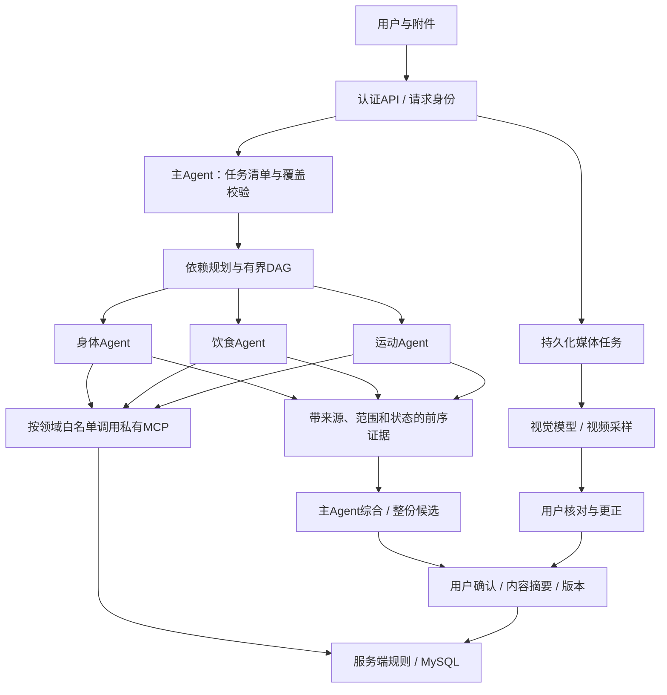

# 主从 Agent 的业务流程与迁移边界

FitLife 帮助个人把运动、饮食和身体信息变成可核对、可回顾的记录与安排。
例如“记录今天体重70公斤、步行20分钟”：主Agent识别两项任务，身体Agent提出身体记录，
运动Agent提出活动记录；主Agent汇成一份候选，用户确认后在同一MySQL事务保存。
拒绝则整份不保存，任一项版本过期则整份失效；需要分别处理时分开提出请求。

## 模块与连接

- `routing.py`：从旧router迁入任务清单、真实工具归属、覆盖和DAG校验；错误最多修正一次。
  必需工具只对只读前序依赖作硬校验；写入工具由子Agent按真实业务选择，权限与参数仍由服务端检查。
  例如步行20分钟使用活动工具，不应被路由误写的详细训练工具提示阻断。
- `master.py`：单领域直接执行，多领域按依赖运行；独立领域并发最多2，依赖方收到实际查询证据。
- `registry.py`：身体、饮食、运动工具及提示词的统一目录，不包含确认工具。
- `agent.py`：共用执行循环；主Agent和子Agent共用模型/工具/步数/token单位预算。
- `model_profiles.py`、`model.py`：选择模型配置与协议；业务Agent不绑定固定供应商。
- `domains.py`、`statistics.py`：领域事实与代码计算；`business.py`处理确认事务。
- `media.py`、`media_worker.py`：上传、任务租约、取消、重试、已完成片段缓存与核对版本。

默认`master`执行DAG，`master_serial`按相同依赖串行执行，`master_independent`为旧A的独立领域策略。`single`保留原0.4的运动10工具基线，
不把它在跨域任务上的能力差异当作编排收益。旧历史实验留在只读源项目供追溯；新版统一执行器下保留独立策略、依赖策略与串行对照，不逐份复制历史代码。

## 数据与副作用

目标、偏好、器械条件、身高和填写时年龄共用`fl_profiles`，有逐字段来源、更新时间和版本。
身体/训练档案工具是该画像的领域视图，不另存一份冲突记忆；体重、步数、训练、食物和餐食是业务事实。
最近6个成功回合/12000字符用于临时对话。明确保存的临时约束带名称、领域、起止日期；
有效集合变化时上下文摘要改变，过期约束的旧会话不重新送入模型。结构化星期、项目与时长限制由计划服务核验；
本轮明确例外在候选中列出并确认，不直接改已保存规则。自由文本note用于解释，不冒充任意自然语言的完整规则校验。
当前明确要求优先于旧偏好；持续影响后续任务的要求应明确保存到画像，单周安排使用计划overrides。

每个子Agent每轮至多提出一项候选。子Agent采集阶段不创建业务事实；主Agent合并同版本、无冲突的画像变更，
再保存一个内容绑定的待确认bundle。部分领域失败时只返回可用查询结果，不产生可确认的部分写入候选。
用户修改要求会使本会话旧候选失效；候选可恢复，不把恢复等同于任意代码位置续跑。

删除本人新领域记录也需确认，绑定ID、版本和内容摘要。删除食物不删除已核算餐食的历史营养快照；
引用该食物的未确认新餐食会失效。已有训练可补充反馈，其他明细修改可确认删除后重新记录。

## 图片与视频

图片先识别标签或食物，未知字段保留null；用户核对后再提交记录候选，模型不能自行确认。
标签保留原始计量基准与kJ/kcal，界面按每100g/ml换算；照片餐食保留估算标记，未知营养不补零。

视频上限180秒/80MB，图片8MB；输入格式检查、解码与尺寸限制由服务端执行。
视频最多48张稀疏采样帧，分组分析并保存采样时间和来源摘要；不宣称整段准确次数、完整组边界或医学动作安全结论。
用户可以核对动作名称，并明确填写实际训练时长；采样跨度不能自动当作训练时长。
当前没有迁移旧视频精析、跨视频连续组拼接和精确计数实验。

媒体任务保存在MySQL。每次真实模型尝试前持久化扣减最多6次调用，最多3次任务尝试；
取消和新租约nonce阻断旧执行者继续提交结果。请求已发出时取消不等于上游立即停止计费。
上传文件仅在项目私有目录，读取需本人认证；删除源文件保留已确认事实及必要操作证据。
